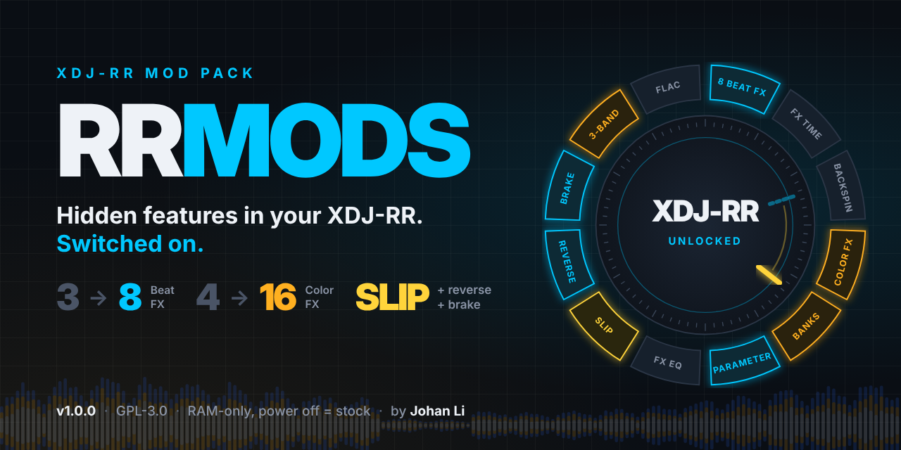
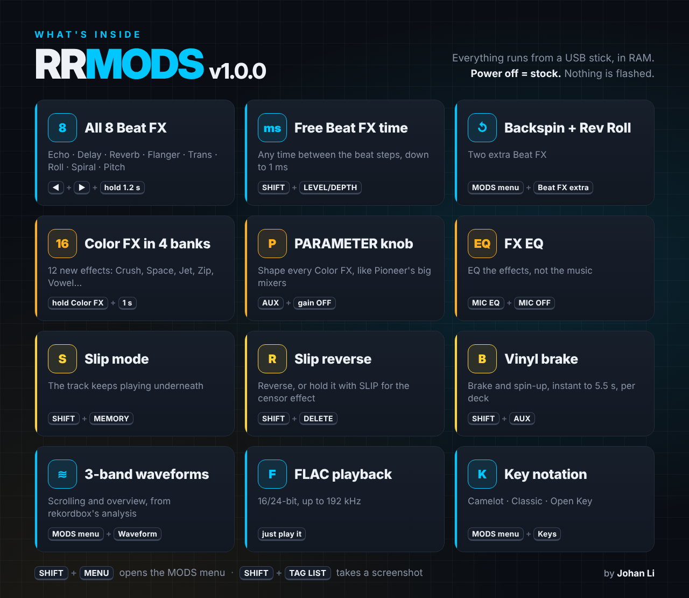
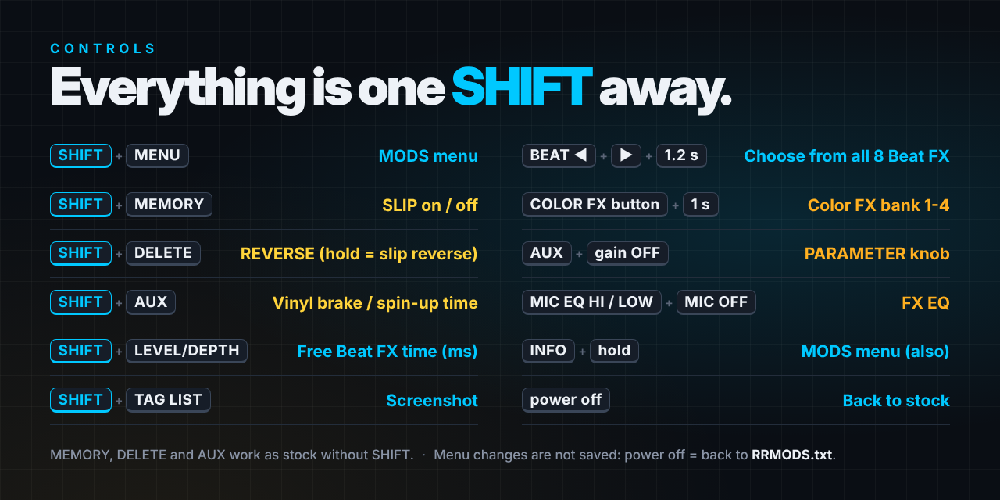

# RRMODS v1.0.0 for the Pioneer XDJ-RR

**Features that were already in the XDJ-RR, switched on, plus a few new ones.** RRMODS runs from a
USB stick, in RAM only. It doesn't install anything, and powering the unit off and on brings
back stock firmware 1.08.

RRMODS replaces [RRFX](https://github.com/DJJohanLi/xdj-rr-rrfx). All 8 Beat FX are still here,
along with a lot more.

> Not affiliated with or endorsed by Pioneer DJ or AlphaTheta. For the **XDJ-RR on firmware 1.08**
> only. On anything else it refuses and changes nothing.

## What's inside

| Feature | How you use it |
|---|---|
| **All 8 Beat FX** (Echo, Delay, Reverb, Flanger, Trans, Roll, Spiral, Pitch) | Hold BEAT ◀ + ▶ for 1.2 s, tap to choose, hold again |
| **Free Beat FX time**, set to the millisecond | SHIFT + turn LEVEL/DEPTH |
| **Backspin and Rev Roll** Beat FX | MODS menu > Beat FX extra |
| **12 new Color FX** in **4 banks** | Hold a Color FX button for 1 s to switch banks |
| **PARAMETER knob** for Color FX | The AUX knob, with the AUX gain switch OFF |
| **FX EQ**: EQ only the effects | The mic EQ HI / LOW knobs, with the MIC switch OFF |
| **Slip mode** | SHIFT + MEMORY |
| **Reverse and slip reverse** | SHIFT + DELETE |
| **Vinyl brake and spin-up** | SHIFT + AUX knob, per deck |
| **3-band waveforms** (scrolling and the overview) | On by default; MODS menu > Waveform |
| **FLAC playback** | Just play FLAC files |
| **Key notation**: Camelot, classic, Open Key | MODS menu > Keys |
| **MODS menu** | SHIFT + MENU |
| **Screenshots** | SHIFT + TAG LIST |
| **Load splash**: version, link, mods loaded | Shows for 3 s after loading |

---

## Install (each time you power on)

You need a USB stick formatted **FAT32**.

1. Download [`RRMODS-v1.0.0.zip`](RRMODS-v1.0.0.zip) (also under [Releases](../../releases)) and unzip it.
2. Copy **`autoexec.bin`** and **`RRMODS.txt`** to the **root** of the stick, not into a folder.
   Your music can be on the same stick.
3. Power on the XDJ-RR and wait until it has **fully booted**.
4. Insert the stick and wait for the USB light to stop blinking (a few seconds).
5. That's it. An RRMODS splash shows for 3 seconds with the number of mods loaded. Press
   **SHIFT + MENU** any time and the MODS menu opens.

The mods stay on until you power off, and you can take the stick out if you like. To use them
again after a power-off, insert the stick again.

**Recommended:** in UTILITY, set **Power Management** (auto standby) to **OFF**. Waking
from standby is a fresh boot, so the mods would be gone.

**Back to stock:** power the unit off and on. Nothing was written to the unit, so it's back to
stock.

**Changing settings:** edit `RRMODS.txt` on your computer and insert the stick again. Most
settings apply at once. Some apply only at the first insert after power-on, so power-cycle if a
change doesn't show. Without `RRMODS.txt` on the stick, `autoexec.bin` does nothing.

---

## The features in detail

### All 8 Beat FX

The XDJ-RR's Beat FX switch reaches only Echo, Reverb and Flanger, but the audio engine inside
has eight. RRFX (from the first release) makes all of them selectable:
**Reverb · Trans · Roll · Flanger · Echo · Delay · Spiral · Pitch**.

1. **Hold BEAT ◀ and ▶ together for 1.2 s**, then let go. You're in select mode.
2. **Tap ◀ or ▶** to step through the eight. Only the name on screen changes.
3. **Hold ◀ + ▶ for 1.2 s again** and let go. The shown effect is now active.

Each effect gets its own name on screen, its own beat steps (or %), FX ON/OFF, LEVEL/DEPTH and
quantize, just like the stock three. 10 s without input cancels select mode. Moving the Beat FX
type switch always takes you back to the stock three. You can also pick an effect in
**MODS menu > Beat FX**.

Beat ranges come from Pioneer's engine: Echo / Delay 1/16–8 beats, Trans / Roll / Spiral 1/16–16,
Flanger 1/16–64, Reverb 1–100 %, Pitch −50…+100 %.

### Free Beat FX time

Hold **SHIFT** (either deck) and turn the Beat FX **LEVEL/DEPTH** knob. The effect time then
moves freely between the beat steps, from the shortest to the longest time the effect allows,
in steps as small as 1 ms. A quarter turn of the knob doubles or halves the time. While you turn,
a box over the beat number shows the time in **ms** (or **%** for Reverb and Pitch).

This works the way the XDJ-RX2's TIME knob does: FX quantize turns off, and the BEAT arrows take
you back to the beat values. While SHIFT is held, the knob doesn't change the effect level. When
you next turn it without SHIFT, the level jumps to where the knob is.

### Backspin and Rev Roll

**MODS menu > Beat FX extra**: OFF, BACKSPIN or REV ROLL. The one you choose takes over the
selected Beat FX, and FX ON/OFF, the beat buttons and LEVEL/DEPTH work as usual.

- **BACKSPIN**: FX ON spins the track backwards like a pushed-back platter, slowing to a stop
  over the beat length (0.12–8 s).
- **REV ROLL**: FX ON plays the last beat length backwards and keeps repeating it until FX OFF.

Choose OFF to get the normal Beat FX back.

### Color FX: 12 new effects in 4 banks

Bank 1 is the stock DUB ECHO, PITCH, NOISE and FILTER. **Hold a Color FX button for 1 second**
to switch banks: **DUB ECHO = bank 1, PITCH = 2, NOISE = 3, FILTER = 4**. The other three LEDs go
dark, and the one you hold blinks fast for 2 s. If an effect is playing, it changes on the fly
to the new bank's effect, keeping the COLOR knob where it is.

| Bank | DUB ECHO button | PITCH button | NOISE button | FILTER button |
|---|---|---|---|---|
| 1 (stock) | Dub Echo | Pitch | Noise | Filter |
| 2 | Filter Echo | Pitch+ | Noise+ | Gate/Comp |
| 3 | Space | Crush | Sweep | Jet |
| 4 | Tremolo | Zip | Classic Sweep | Vowel |

| Effect | COLOR left | COLOR right |
|---|---|---|
| Filter Echo | low-pass + echo | high-pass + echo |
| Pitch+ | pitch down | pitch up (±1 octave) |
| Noise+ | noise filter down | noise filter up (follows the channel TRIM, like stock Noise) |
| Gate/Comp | gate | compressor |
| Space | reverb | reverb |
| Crush | bit crush | bit crush |
| Sweep | gate | band-pass |
| Jet | flanger, lower | flanger, higher |
| Tremolo | wobble | chop, in time with the deck |
| Zip | pitch zips down | pitch zips up |
| Classic Sweep | notch sweep | band-pass sweep |
| Vowel | "oo" | "ee" |

You can set up your own banks in `RRMODS.txt` (see [Settings](#settings-rrmodstxt)).
**MODS menu > Color FX bank** also switches banks.

### PARAMETER: the AUX knob

Pioneer's bigger mixers have a PARAMETER knob that changes how each Color FX sounds, and the
XDJ-RR has Pioneer's PARAMETER code but never uses it. With the **AUX gain switch OFF**, the
**AUX knob** becomes PARAMETER, shared by both decks. At the centre every effect sounds stock.

| Effect | Knob left | Knob right |
|---|---|---|
| Filter (stock) | no resonance | strong resonance |
| Dub Echo (stock) | shorter echo | longer echo |
| Crush | lighter | deeper |
| Sweep | band lower / gate looser | band higher / gate tighter |
| Space | shorter tail | longer tail |
| Noise+ | noise −12 dB | noise +12 dB |
| Pitch+ | range ±1 semitone | range ±2 octaves |
| Jet | little resonance | strong resonance |
| Gate/Comp | gate looser / softer | gate tighter / harder |
| Filter Echo | short echo | long echo |
| Tremolo / Zip / Classic Sweep / Vowel | the knob sets depth / zip length / bandwidth / resonance | |

Stock Pitch and Noise have no PARAMETER. With AUX set to LINE or PORTABLE, the aux input works as
stock.

### FX EQ: EQ the effects, not the music

With the **MIC switch OFF**, the mic's **EQ HI** and **EQ LOW** knobs shape only the sound of
the effects, Beat FX and Color FX: fully left −26 dB, centre 0 dB, fully right +6 dB. Take the
lows out of an echo tail while the track plays on untouched. Switch the MIC on (or TALKOVER) and
the knobs belong to the mic again. The Color FX FILTER is left alone (it is an EQ itself).

### Slip mode, reverse and vinyl brake

Pioneer's player engine has slip mode, slip reverse and a vinyl brake, but the XDJ-RR has no
buttons for them. RRMODS puts them on SHIFT, on each deck:

| Control | Does |
|---|---|
| **SHIFT + MEMORY** | **SLIP** on / off for that deck. The playhead turns yellow while the track plays on in the background. |
| **SHIFT + DELETE** | **REV**: reverse on / off. **With SLIP on, hold it**: the track plays backwards, and when you let go it jumps back to where it would have been (the "censor" effect). Ends by itself after 8 beats. |
| **SHIFT + AUX knob** | **Vinyl brake / spin-up time** for that deck: fully left = instant (stock), centre about 0.3 s, fully right about 5.5 s for a full stop or start. |

With SLIP on, scratch or hold reverse, then let go, and the track carries on as if you never
touched it. While SHIFT is held, MEMORY and DELETE don't touch your memory cues. Without
SHIFT they work as normal.

**MODS menu > Deck settings:**

| Line | Values | Does |
|---|---|---|
| SLIP after load | ON / OFF | The player turns SLIP off when you load a track. With ON, it comes back on by itself. |
| Brake mode | T&R / TOUCH / RELEASE | When the brake time applies: jog touch and release, touch only, or release only. This is a hidden setting from the XDJ-RX2. |
| Brake D1, Brake D2 | instant, 10 ms … 5.54 s | The brake time per deck, in Pioneer's own steps |
| Needle Lock | LOCK / UNLOCK | Reserved for needle search, coming in a later version. No effect yet. |

Note: with SLIP on, letting go of the jog brings the deck straight back at full speed on the
slip position, with no slow start. That's how Pioneer's slip mode works, and RRMODS keeps it.

### 3-band waveforms

The scrolling waveforms and the overview at the bottom are drawn in three bands, like on newer
Pioneer players: blue lows, amber mids and white highs. RRMODS uses rekordbox's own analysis on
your stick and never writes anything to it. Tracks exported by older rekordbox versions (without
that analysis) keep the stock waveform; export them again from a recent rekordbox. Switch
between 3-BAND and STOCK in **MODS menu > Waveform**.

### FLAC

FLAC files play like WAV, from your rekordbox library or from folder browsing. Folder browsing
shows their tags. 16 and 24-bit, mono or stereo, 44.1 / 48 kHz as they are; 88.2 / 96 / 176.4 /
192 kHz are converted down. Insert your music stick **after** the mods have loaded (or re-insert
it) so FLACs show up in folder view.

### Key notation

**MODS menu > Keys**: AS EXPORTED, CAMELOT (1A–12B), CLASSIC (Abm, B, F#m…) or OPEN KEY (1m–12d),
whatever rekordbox exported. Only the displayed name changes.

### MODS menu

**SHIFT + MENU** opens and closes it (holding **INFO** or holding **SHIFT + BACK** opens it
too). Turn the browse knob to move, push it to select, BACK goes one step back. While the menu
is open, the knob and BACK work only the menu, and every other control works as normal. The
menu closes by itself after 20 s, or when you press LOAD, BROWSE, TAG LIST, INFO, MENU or a
source button.

Items: Beat FX mod, Beat FX, Beat FX extra, Color FX, Color FX bank, Waveform, Keys, Deck
settings, Info, Screenshot, Browser, Close. **Info** shows the version, which modules run, and
the player's CPU and memory.

Changes in the menu are **not saved**. After a power-off, `RRMODS.txt` decides again.

### Load splash

When the mods have loaded, a card shows for 3 seconds: the version, the link to this page and how
many mods loaded. If a part refused (see [Troubleshooting](#troubleshooting)), it says so in amber.
It shows once per power-on and takes no input. Turn it off with `splash = off`.

### Screenshots

**SHIFT + TAG LIST** saves what the screen shows, at any time (up to 9 per power-on). They come
back on the stick the next time you insert it, in `RRMODS_LOG/attempt-N/shot-N.raw` (800 × 480,
RGB565). To turn one into a PNG:
`ffmpeg -f rawvideo -pix_fmt rgb565le -s 800x480 -i shot-1.raw shot-1.png`

### MODS browser (experimental)

**MODS menu > Browser: MODS** makes BROWSE open an alternative library browser (title, artist,
BPM, key, time) over the top of the screen. LOAD 1 / LOAD 2 load the highlighted track (a deck
that is playing won't take a load, as stock). Set it back to STOCK to get Pioneer's browser.

---

## Settings: `RRMODS.txt`

One `name = value` per line; anything after `#` is ignored. The file in the zip has everything
on. The most useful lines:

| Setting | Values |
|---|---|
| `rrfx` | `on` / `off`: all 8 Beat FX |
| `rrfx_select` | `1`–`8` or a name (`spiral`): pick a Beat FX when the stick goes in |
| `colorfx` | bank 1: `stock`, `off`, or your own list (below) |
| `colorfx_bank2` … `colorfx_bank4` | a list like `filterecho dubecho, pitchplus pitch, noiseplus noise, gatecomp filter`, or `stock` |
| `menu`, `menu_alpha` | the MODS menu `on` / `off`; see-through `0`–`255` (255 = solid) |
| `splash` | `on` / `off`: the 3 s load splash |
| `fxtime` | `on` / `off`: free Beat FX time |
| `beatx` | `on` / `off` / `backspin` / `revroll` |
| `parameter` | `on` / `off`: AUX knob as PARAMETER |
| `fxeq` | `on` / `off`; `fxeq_low_hz` (40–2000, default 250) and `fxeq_high_hz` (500–16000, default 2500) |
| `slip` | `on` / `off`: the SHIFT slip controls and Deck settings |
| `slipkeep` | `on` / `off`: SLIP after load |
| `wave`, `wave_overview` | `on` / `off`: 3-band waveforms, and the overview too |
| `keys` | `exported`, `camelot`, `classic`, `openkey`, `off` |
| `flac` | `on` / `off` |
| `browse`, `browser` | library reader (needed for Screenshot) `on` / `off`; `stock` / `mods` |
| `cpu_log`, `debug` | extra logging for bug reports, `off` normally |

**Your own Color FX banks:** a list of `effect button` pairs. Effects: `crush`, `sweep`, `space`,
`noiseplus`, `pitchplus`, `jet`, `gatecomp`, `filterecho`, `tremolo`, `zip`, `classicsweep`,
`vowel`. Buttons: `dubecho`, `pitch`, `noise`, `filter`. A button you don't list keeps its stock
effect. Example: `colorfx_bank2 = space dubecho, crush pitch`.

Each bank uses memory, which isn't given back until power-off. After about six Color FX setting
changes (re-inserting the stick with new banks) in one session, Color FX refuses until the next
power-on.

---

## Good to know

- **Firmware 1.08 only.** Every part checks that the player's code is exactly as expected before
  it changes anything. If something doesn't match, that part refuses and leaves the unit alone,
  and the rest carries on.
- **rekordbox (PC) mode:** when the XDJ-RR is connected to rekordbox, rekordbox controls the
  effects. RRMODS is made for standalone USB play.
- **Live use:** test your setup at home first. If anything ever seems wrong, a power cycle
  takes the unit back to stock.
- **The stick gets a log folder** `RRMODS_LOG/attempt-N/` each time you insert it, for bug
  reports. **Delete the `RRMODS_LOG` folder now and then:** v1.0.0 makes at most 100 attempt
  folders, and once `attempt-100` exists the mods no longer load from that stick (nothing is
  changed on the unit). Deleting the folder is always safe.

## Troubleshooting

Open `RRMODS_LOG/attempt-N/log.txt` on the stick (the highest N). The last `RESULT=` line says
what happened:

| RESULT | Meaning |
|---|---|
| `LOADED` | Working. The `MODULE` lines show each part. |
| `RBP_IDENTITY_REFUSED` | Not firmware 1.08. Nothing was changed. |
| `OTHER_BUILD_..._REBOOT_FIRST` | Another version (RRFX or an older RRMODS) was loaded since power-on. Power-cycle, then insert again. |
| `SELECT_OK_<name>` | `rrfx_select` picked that Beat FX. |
| anything else | Nothing was changed. Please report it (below). |

`MODULE <name> REFUSED` means that part found something unexpected and left the unit alone. The
others still work.

**No log folder at all?** The stick must be FAT32, with `autoexec.bin` and `RRMODS.txt` in the
root, inserted after the unit has fully booted.

**Worked before, now nothing loads and no new attempt folder appears?** `RRMODS_LOG` has reached
`attempt-100`. Delete the `RRMODS_LOG` folder and insert the stick again.

**Bug reports:** open a [GitHub issue](../../issues) and attach the whole `RRMODS_LOG` folder.
Please don't send bug reports through social media.

## Disclaimer

RRMODS is provided **as-is, without warranty of any kind** (see sections 15 and 16 of the
[LICENSE](LICENSE)). It isn't custom firmware, and nothing is written to the unit's flash
memory. It runs in RAM, and a power cycle always returns the unit to stock firmware 1.08, so a
problem is unlikely to be permanent. Still, **the author takes no responsibility for any failure,
damage or loss**, including a unit freezing during a live set.

## Credits

Made by **Johan Li** ([linktr.ee/djjohanli](https://linktr.ee/djjohanli)). Co-authored by
**Claude** (Anthropic's AI assistant): the reverse engineering, code, tests and documentation
were done together with Claude.

Thanks to OpticMystic's [XZ Mods](https://github.com/OpticMystic/XZ-Mods) for the rekordbox library
reader and layered waveform code (MIT, © VJ.Tools), and to [dr_flac](https://github.com/mackron/dr_libs)
by David Reid (public domain / MIT-0). See [THIRD_PARTY_NOTICES.md](THIRD_PARTY_NOTICES.md).

## License and source

RRMODS is free software under the **GNU GPL v3.0 or later** ([LICENSE](LICENSE)). This repository
holds the release and its documentation. The full source code will be published here later, and
until then anyone who has the release can ask for it by opening an issue. It contains no
Pioneer / AlphaTheta firmware, code, keys or graphics.
